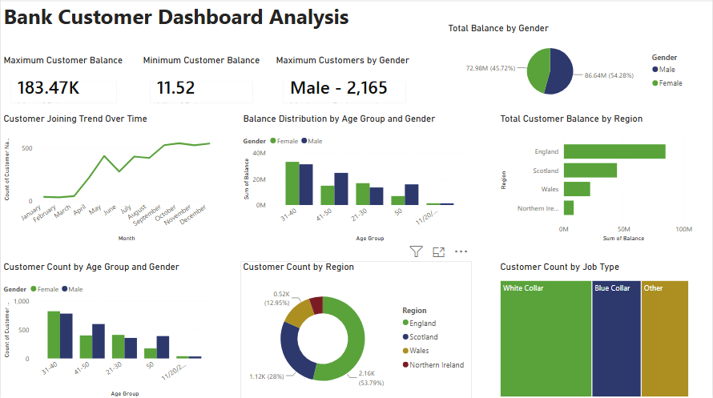
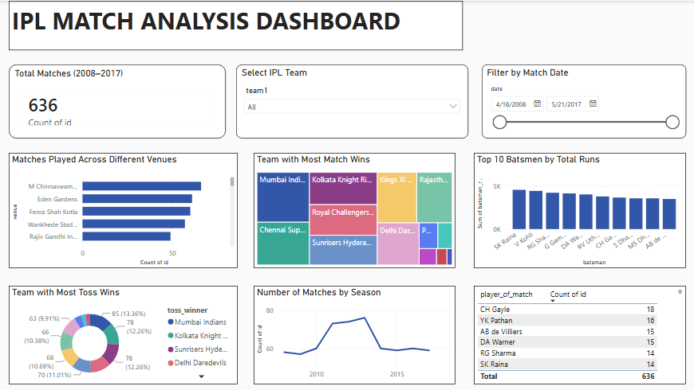
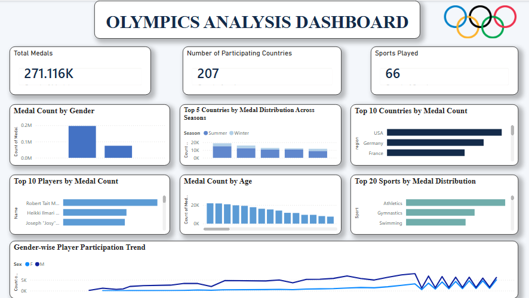
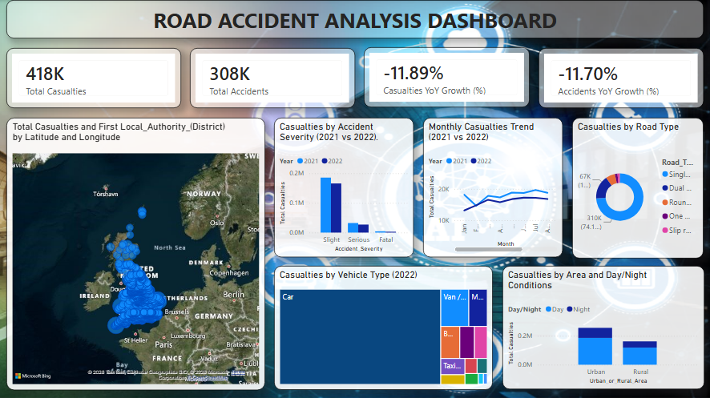
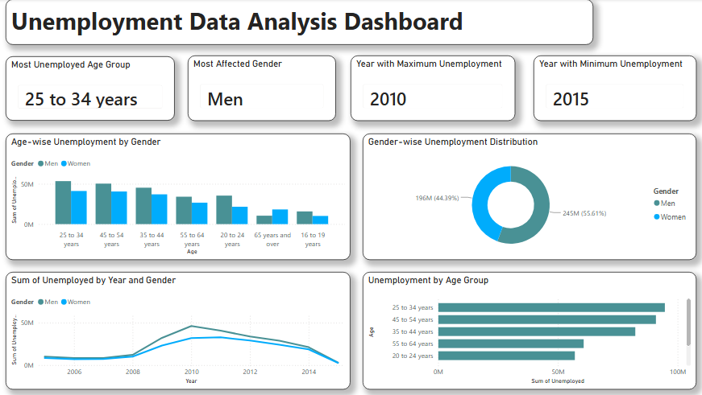
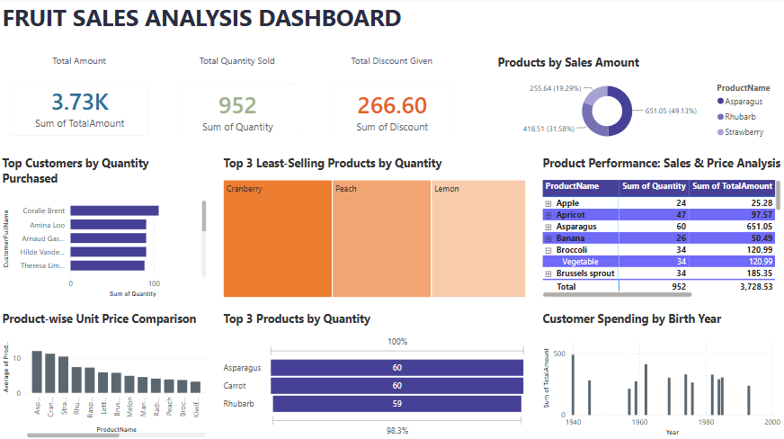
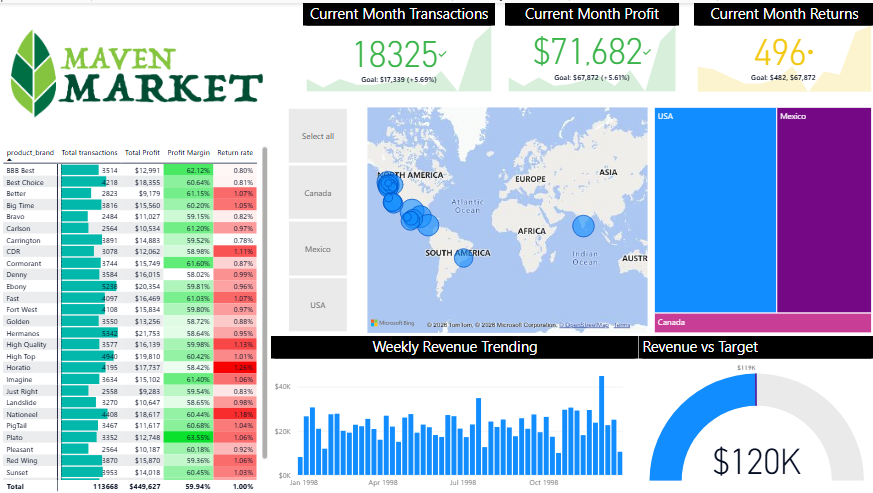
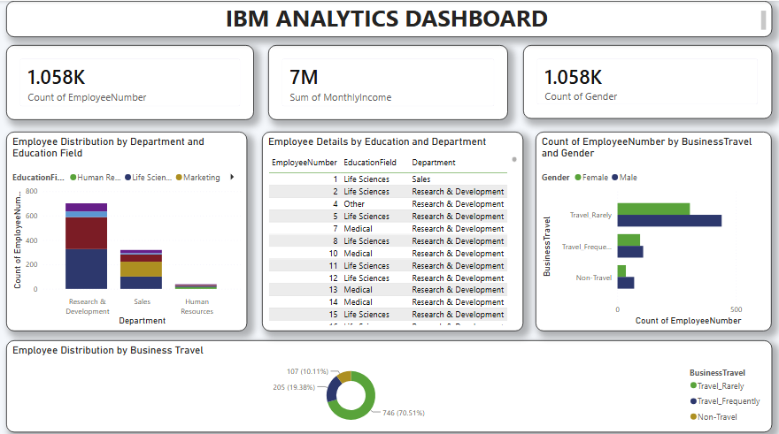
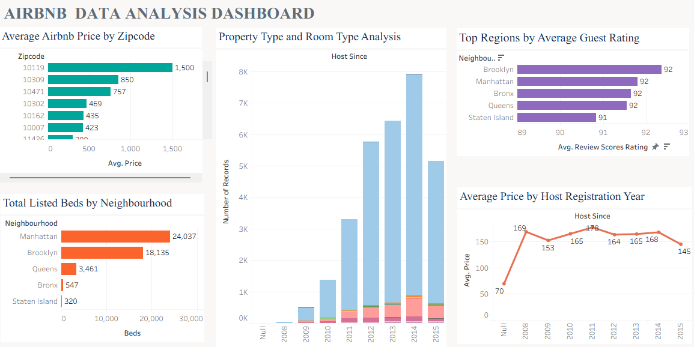
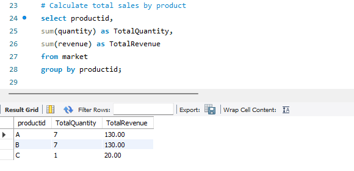

# Data Analytics Final Project

## Overview

This repository showcases the data analytics projects and assignments I completed as part of my training at Intilaq Technologies, covering SQL, Microsoft Power BI, Tableau, Python and Microsoft Excel.

The project demonstrates the complete data analysis workflow: extracting and transforming data, writing queries, creating visual dashboards, building a predictive model, and presenting results.

## Objective

- Practice SQL querying and analytical problem-solving
- Analyze datasets using Python and Excel
- Build interactive Power BI and Tableau dashboards
- Use machine learning to predict advertising click behavior
- Present insights in a clear and reproducible format

## Project Preview

### Power BI Dashboards

**Example: Bank Customer Analysis Dashboard**



**Example: IPL Dashboard**



**Example: Olympics Dashboard**



**Example: Road Accident Dashboard**



**Example: Unemployment Dashboard**



**Example: Fruit Sales Analysis Dashboard**



**Example: Maven Market Dashboard**



**Example: IBM Dashboard**



### Tableau Dashboard

**Example: Airbnb US Data Analysis**




---

## SQL Assignments

The SQL section contains database creation, table creation, data insertion, filtering, joins, aggregation, ranking, and duplicate-removal exercises.

| Assignment | Key Concepts | File |
|---|---|---|
| Market Analysis | Revenue, grouping, ranking | [View SQL](FINAL_PROJECT/SQL_PROJECTS/MARKET_ANALYSIS.sql) |
| Average Selling Price | Aggregate functions | [View SQL](FINAL_PROJECT/SQL_PROJECTS/AVERAGE_SELLING_PRICE.sql) |
| Bank Account Summary | Financial aggregation | [View SQL](FINAL_PROJECT/SQL_PROJECTS/BANK_ACCOUNT_SUMMARY.sql) |
| Customers Who Never Ordered | Filtering and joins | [View SQL](FINAL_PROJECT/SQL_PROJECTS/CUSTOMER_NEVER_ORDER.sql) |
| Delete Duplicate Emails | Duplicate records | [View SQL](FINAL_PROJECT/SQL_PROJECTS/DELETE_DUPLICATE_EMAILS.sql) |
| Fix Names in a Table | Text formatting | [View SQL](FINAL_PROJECT/SQL_PROJECTS/FIX_NAMES_IN_A_TABLE.sql) |
| Ride Cancellation Rate | Joins and conditional aggregation | [View SQL](FINAL_PROJECT/SQL_PROJECTS/RIDE_CANCELLATION_RATE.sql) |
| Top Performing Ads | Ranking and ad performance | [View SQL](FINAL_PROJECT/SQL_PROJECTS/TOP_PERFORMING_ADS.sql) |
| User Engagement Analysis | Engagement metrics | [View SQL](FINAL_PROJECT/SQL_PROJECTS/USER_ENGAGEMENT_ANALYSIS.sql) |
| Product Sales Analysis | Sales analysis and aggregation | [View SQL](FINAL_PROJECT/SQL_PROJECTS/PRODUCT_SALES_ANALYSIS.sql) |

### Example SQL Output



```sql
SELECT productid,
       SUM(quantity) AS TotalQuantity,
       SUM(revenue) AS TotalRevenue
FROM market
GROUP BY productid;
```

---


## Python and Machine Learning Assignment

The Advertising Data Project uses customer demographic and internet usage information to predict whether a user clicked on an advertisement.

**Notebook:** [Open Jupyter Notebook](FINAL_PROJECT/PYTHON_PROJECT_ADVERTISING/PROJECT%20Question%20%28Advertising%20%29%20%20%281%29.ipynb)

### Features Used

- Daily time spent on the website
- Age
- Area income
- Daily internet usage
- Advertisement topic
- City
- Gender
- Country
- Timestamp

### Machine Learning Model

- Algorithm: Logistic Regression
- Target: `Clicked on Ad`
- Libraries: Pandas, NumPy, Matplotlib, Seaborn, and Scikit-learn

**Data requirement:** The notebook references `advertising.csv`. This file must be placed in the Python project folder to run the notebook.

---

## Excel Assignment

**Virtual Gaming Startup Case Study**

This case study analyzes a virtual gaming startup using an Excel workbook.

[Open Excel Workbook](FINAL_PROJECT/VIRTUAL_GAMING_CASE_STUDY_EXCEL/Copy%20of%20Case%20Study_Virtual%20Gaming%20Startup%20.xlsx)

---

## Tools Used

- Database: MySQL
- Data Visualization: Microsoft Power BI, Tableau
- Programming: Python
- Data Analysis: Pandas, NumPy
- Data Visualization Libraries: Matplotlib, Seaborn
- Machine Learning: Scikit-learn
- Spreadsheet: Microsoft Excel
- Development Environment: Jupyter Notebook

## Key Learning

- Hands-on experience in SQL queries and database management.
- Experience in data cleaning and exploratory data analysis.
- Developed interactive dashboards using Power BI and Tableau.
- Applied machine learning techniques using Python.
- Improved analytical thinking and data visualization skills.

## How to View the Projects

1. Download or clone this repository.
2. Open `.sql` files in MySQL or another compatible SQL editor.
3. Open `.pbix` files in Microsoft Power BI Desktop.
4. Open `.twbx` files in Tableau Desktop.
5. Open `.ipynb` files in Jupyter Notebook or VS Code.
6. Open `.xlsx` files in Microsoft Excel or an Excel-compatible application.

## Repository Structure

```text
screenshots/
└── Exported images used in this README

FINAL_PROJECT/
├── POWERBI_PROJECTS/
├── PYTHON_PROJECT_ADVERTISING/
├── SQL_PROJECTS/
├── TABLEAU_PROJECTS/
└── VIRTUAL_GAMING_CASE_STUDY_EXCEL/
```
